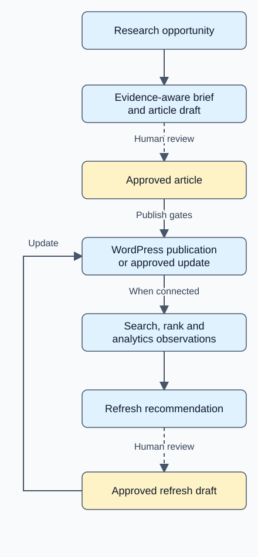

# SEO Agent

**A customer-reviewed SEO content and measurement platform**

Research search opportunities, build evidence-aware briefs, publish approved WordPress articles, and use search and analytics data to propose the next action.

[Architecture](docs/architecture.md) · [Validation](docs/validation.md) · [View runnable code](examples/outcome_gate.mjs) · [Customer and operator workflow](docs/walkthrough.md)

For teams managing business websites, the hard part is connecting research, publishing, and results without losing human control or mistaking missing data for poor performance. SEO Agent brings those steps into separate customer and operator workspaces, backed by scoped jobs and explicit approval states.

## Engineering highlights

- **Make measurement honest.** Canonical URL matching and evidence floors separate missing integrations, insufficient observations, and measured outcomes. A page with no analytics connection is not assigned zero conversions.
- **Make background work portable.** A shared dispatcher supports a PostgreSQL-backed Railway worker and an optional Trigger.dev backend. The stage logic, signed scope, lifecycle and accounting survive the backend change.
- **Keep decisions with the customer.** Customer admins review drafts and opportunities; operator interventions use explicit support paths. Internal-link proposals are review-only in the inspected implementation.
- **Bound paid work.** Reserve tenant budget before vendor calls, persist recoverable artifacts with usage, and enforce pauses and deterministic scheduling keys. Queueing work does not itself incur vendor usage.
- **Preserve evidence quality.** Organic result position stays separate from absolute search-page rank. Missing top-band sources cannot be replaced silently by lower-ranked pages; weak briefs can stop before expensive generation.

## Verified evidence

| Evidence | Scope and result |
| --- | --- |
| Source CI, 2026-09-11 | **1,077 passed, 21 skipped / 1,098 tests** across 91 files |
| Separate auth-simulation job | **41/41 passed** across 5 files; overlaps the main suite |
| Migration re-run check | **92 ledger rows** at head after the workflow reapplied migrations |
| Recorded hosted publication acceptance | **One draft → browser approval → WordPress publication**; 9 Chromium smoke checks |

CI also completed typecheck, build, and configured lint gates. These are engineering checks, not ranking lift, model accuracy, or customer impact. [Methods, exclusions and historical proofs](docs/validation.md) · [Aggregate JSON](evidence/metrics.json).

## Product loop

Solid arrows show processing. Dashed arrows require human review. Measurement depends on integrations and scheduled observations; a recommendation does not automatically change a live page. [Deployment boundaries and detailed flows](docs/architecture.md).

## A decision you can inspect

A conversion count only becomes meaningful when its denominator and measurement window are known. The current classifier uses provisional age and session floors before returning a conversion verdict.

| Synthetic situation | Outcome |
| --- | --- |
| Analytics disconnected; no observations | Missing integration |
| Connected; no observations | Unknown |
| Conversions supplied without session counts | Insufficient data |
| Mature page, enough sessions, zero conversions | Not converting |

**[View the illustrative outcome gate](examples/outcome_gate.mjs)** · [Source-recovery example](examples/source_gate.mjs) · [Run both examples](examples/README.md)

These standalone examples use invented inputs and make no external calls. They demonstrate selected decisions, not the full production classifier or application.

## Current capabilities and boundaries

**Implemented:** customer/admin workspaces, website and team management, customer draft approval and send-back, keyword and refresh requests, Google connection flow, evidence-aware research, drafting, WordPress publishing and approved refreshes, GSC/GA4 imports, rank observations, recurring discovery, and opportunity review.

**Controlled or review-only:** paid discovery requires source enablement and budget gates; authority features use entitlement and pause controls. Backlink monitoring, link-gap worksheets and internal-link planning are implemented. The recorded internal-link proof produced proposals without modifying WordPress.

**Not claimed as complete:** automatic internal-link application/revert, landing-page brief and brand-refresh workflows, independent claim-by-claim fact verification, and draft-ready email delivery. Some later stages have schema or registry entries without an execution implementation.

[Walk through customer, customer-admin and operator responsibilities](docs/walkthrough.md).

## Technology

- **Product:** TypeScript, Next.js, React, Supabase Auth and PostgreSQL.
- **Execution and hosting:** Vercel web app, Railway database worker, optional Trigger.dev adapter.
- **Research and generation:** DataForSEO, guarded fetch/Readability, optional Firecrawl recovery, Anthropic models.
- **Publishing and measurement:** WordPress REST API, Google Search Console, Google Analytics 4, OAuth.
- **Verification:** Vitest, PostgreSQL integration tests, Playwright, migration content probes and architectural lint checks.

## Public access

This repository contains newly written documentation, aggregate evidence, reviewed diagrams, and synthetic runnable examples. Application source, customer records, fetched content, credentials, deployment identifiers and original Git history remain private. There is no public demo or product screenshot in this showcase. No open-source license has been added.
