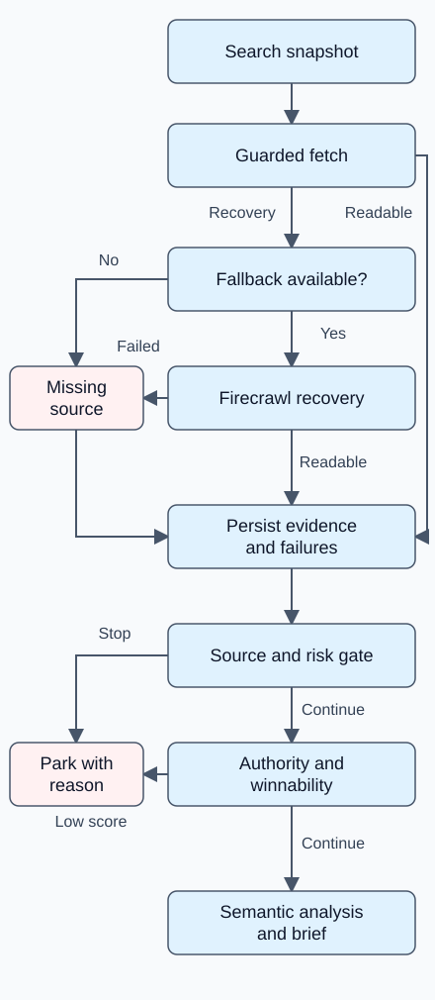
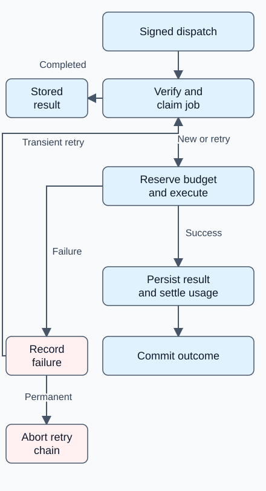

# Architecture and engineering decisions

[← Project overview](../README.md) · [Validation](validation.md) · [Workflow](walkthrough.md)

## Deployment and responsibility boundaries

The Next.js application runs on Vercel. Supabase supplies authentication, PostgreSQL state, policies and storage. A long-running Railway process claims database-backed jobs; Trigger.dev remains a selectable backend. The current Stage 3 operating design uses the database worker for measurement and refresh work. The code defaults to Trigger when no backend is configured, so a selectable fallback must not be confused with automatic failover.

Customer routes expose articles, websites, opportunities, measurement and account state. Operator routes expose cross-tenant support, credentials, diagnostics and recovery. Privileged server modules and worker claim bookkeeping use elevated access; actual pipeline work runs with a restricted database role. Customer-facing reads do not expose raw job payloads or provider diagnostics.

Signed claims bind tenant, project, allowed stages, run identity and a validity window. Database verification supplies scope, rather than trusting an arbitrary task argument. Scope tokens themselves are signed; row-level policies and composite references constrain both access and relationships. Stored job payloads have per-stage allowlists that reject credential-like fields. Customer actions also check membership, role, disabled state and object scope.

These controls are implementation and test evidence, not an independent security certification. The worker runbook currently calls for a single replica because inner job finalization is not fully fenced by lease ownership; the showcase does not claim horizontally scaled execution.

## Research: preserve the denominator

A search snapshot feeds guarded page fetches. Firecrawl is a conditional recovery path. Every attempted source has an explicit outcome. Organic ordinal is assigned before dropping unreadable pages: the tenth organic result may be below absolute rank ten when search features occupy slots.

The top ten organic results define recovery. Fewer than five readable sources parks a brief; five to seven degrades it; eight or more clears the recovery floor. Risk and winnability can still park it. A strict risk profile parks flagged or failed classifications, and pending classification blocks construction. These are policy gates, not calibrated ranking probabilities.

Layer A computes structural medians and interquartile ranges. Layer B interprets evidence; optional support from organic positions 11–15 does not inflate top-ten recovery. Semantic relevance can downgrade a brief after intent-outlier exclusion. The composer proposes prose and outline structure under deterministic constraints; required coverage omitted by the model is restored and recorded. Model output is checked rather than accepted as authority.

## Durable jobs and paid work

A dispatcher attaches the chosen backend to a prepared pending job. The database worker claims eligible rows using a lease, refreshes heartbeats, verifies stored claims against the row, and calls the same job runner used by the Trigger adapter. The runner remains the lifecycle writer; the worker manages claim and retry scheduling metadata.

Claim, work, and outcome are separate commits so failure cannot erase its own report. Paid units reserve budget before calls and settle usage with recoverable artifacts. Deterministic stage and usage keys prevent repeated local accounting. Source-specific recurrence, pauses, cooldowns and enablement gates constrain scheduled work. Permanent signature/input/budget failures abort or block; transient failures may retry. No claim of exactly-once execution across all external systems is made.

An instructive design change was separating accepted dispatch from actual execution. Historical Stage 3 work could receive a provider run identifier without a worker attempt starting. Because durable job identity, scope, accounting and stage bodies already lived outside the provider adapter, the database-backed executor could reuse those contracts. Operators can distinguish pending handoff, claimed attempt, blocked work and a terminal result.

## Publishing and customer review

Customer admins approve or send back drafts in the application; ordinary members can read evidence and request work. Publication checks scoped article state and a per-project publishing ramp, then uses a slug-based WordPress upsert and stores a receipt. An existing receipt can be reused, and slug lookup can recover an already-created post on retry. This improves recovery over a create-only call but is not a distributed transaction or a proof against every concurrent race.

Approved refresh work updates an existing post and records its result. Recommendations and requests do not substitute for review. Draft claim candidates are still not independently verified claims. Internal-link planning reads current WordPress content and produces proposals with source revision and content hashes; the inspected planning slice has no WordPress mutation path.

## Measurement and recommendations

GSC, GA4 and rank imports persist scoped snapshots for article or landing-page targets. URL identity distinguishes exact canonical matches, redirect matches, query variants, host-only evidence, ambiguity and absence. Ambiguous identity blocks trustworthy attribution instead of assigning a vendor row to an arbitrary page.

Ranking and conversion outcomes are separate. The current provisional conversion floor uses a minimum page age of 28 days and at least 20 current-window sessions. A conversions-only observation fails the denominator check. Missing integration, unknown data and insufficient data remain distinct from a measured zero. Ranking has its own impression/click/observation floors. These thresholds are product heuristics, not statistical significance tests.

Recommendations can lead to human-reviewed refresh work. Imported measurements can also feed opportunity discovery, alongside explicitly enabled paid trend/competitor sources. There is no automatic model retraining or unreviewed acceptance of proposed content changes.

## Trace to the implementation

Private source identifiers reviewed include `lib/jobs/dispatcher.ts`, `admin/db-worker.ts`, `lib/job-run.ts`, `lib/usage.ts`, `lib/job-payload.ts`, `lib/analysis/stages.ts`, `lib/stage3/outcomes.ts`, `lib/stage3/url-identity.ts`, `lib/publish/article.ts`, `lib/vendors/wordpress.ts`, `lib/stage5/internal-links.ts`, and the customer article actions. They are audit references, not public code links. The public [examples](../examples/README.md) isolate two decisions using newly written code.
